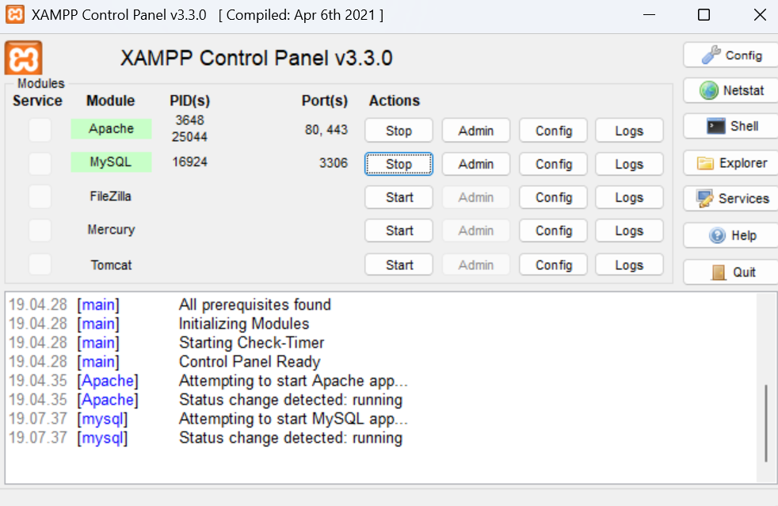

# Praktikum 8: PHP dan Database MySQL (Lab8Web)

## Identitas Mahasiswa

| Keterangan | Detail |
| :--- | :--- |
| Nama | Satrio Erlangga |
| NIM | 312510006 |
| Kelas | I253C |
| Program Studi | Teknik Informatika |
| Fakultas | Fakultas Teknik |
| Universitas | Universitas Pelita Bangsa |
| Mata Kuliah | Pemrograman Web |

## Tujuan Praktikum

1. Memahami konsep dasar Database menggunakan MySQL.
2. Memahami konsep dasar operasi CRUD (Create, Read, Update, Delete) menggunakan PHP.
3. Mampu membuat program aplikasi CRUD sederhana berbasis PHP dan MySQL.

## Struktur Direktori Proyek

Letakkan seluruh file proyek pada direktori web server lokal `C:\xampp\htdocs\lab8_php_database\` dan akses melalui `http://localhost/lab8_php_database/`.

```text
Lab8Web/
├── gambar/
│   └── (file gambar barang hasil upload / data awal)
├── screenshots/
│   ├── 01_xampp_control.png
│   ├── 02_phpmyadmin_buat_database_tabel.png
│   ├── 03_insert_data_barang.png
│   ├── 04_directory_lab8.png
│   ├── 05_tes_koneksi.png
│   ├── 06_tampilan_index.png
│   ├── 07_form_tambah_barang.png
│   ├── 08_hasil_tambah_barang.png
│   ├── 09_form_ubah_barang.png
│   ├── 10_hasil_ubah_barang.png
│   └── 11_hasil_hapus_barang.png
├── database.sql
├── koneksi.php
├── index.php
├── tambah.php
├── ubah.php
├── hapus.php
├── style.css
└── README.md
```

---

## Langkah-langkah Praktikum

### 1. Persiapan dan Menjalankan MySQL Server

Sebelum membuat aplikasi CRUD, jalankan layanan **Apache** dan **MySQL** melalui XAMPP Control Panel. Setelah kedua layanan aktif (berwarna hijau), buka phpMyAdmin melalui browser pada alamat `http://localhost/phpmyadmin/`.



---

### 2. Membuat Database dan Tabel (`database.sql`)

Pada tahap ini dibuat database bernama `latihan1` serta tabel `data_barang` dengan field `id_barang` (Primary Key, Auto Increment), `kategori`, `nama`, `gambar`, `harga_beli`, `harga_jual`, dan `stok`.

```sql
CREATE DATABASE latihan1;
USE latihan1;

CREATE TABLE data_barang (
    id_barang int(10) auto_increment Primary Key,
    kategori varchar(30),
    nama varchar(30),
    gambar varchar(100),
    harga_beli decimal(10,0),
    harga_jual decimal(10,0),
    stok int(4)
);
```


---

### 3. Menambahkan Data Awal (`INSERT INTO`)

Setelah tabel `data_barang` terbentuk, masukkan tiga data awal barang elektronik menggunakan perintah SQL `INSERT INTO` melalui tab SQL di phpMyAdmin (atau import langsung file `database.sql`).

```sql
INSERT INTO data_barang (kategori, nama, gambar, harga_beli, harga_jual, stok)
VALUES
('Elektronik', 'HP Samsung Android', 'hp_samsung.jpg', 2000000, 2400000, 5),
('Elektronik', 'HP Xiaomi Android', 'hp_xiaomi.jpg', 1000000, 1400000, 5),
('Elektronik', 'HP OPPO Android', 'hp_oppo.jpg', 1800000, 2300000, 5);
```


---

### 4. Membuat Folder Proyek `lab8_php_database`

Buat folder baru bernama `lab8_php_database` di dalam direktori `C:\xampp\htdocs\`, lalu akses melalui browser di alamat `http://localhost/lab8_php_database/` untuk memastikan direktori terbaca oleh Apache.


---

### 5. Membuat File Koneksi Database (`koneksi.php`)

File `koneksi.php` digunakan untuk menghubungkan aplikasi PHP ke server MySQL (`latihan1`) menggunakan fungsi `mysqli_connect()`. Untuk melakukan pengujian koneksi di browser (`http://localhost/lab8_php_database/koneksi.php`), hapus sementara tanda komentar `#` pada baris `#else echo "Koneksi berhasil";`, lalu kembalikan tanda komentarnya setelah pengujian berhasil.

```php
<?php
$host = "localhost";
$user = "root";
$pass = "";
$db   = "latihan1";

$conn = mysqli_connect($host, $user, $pass, $db);
if ($conn == false)
{
    echo "Koneksi ke server gagal.";
    die();
} #else echo "Koneksi berhasil";
?>
```


---

### 6. Menampilkan Data Barang - Read (`index.php` dan `style.css`)

File `index.php` mengambil seluruh baris dari tabel `data_barang` menggunakan query `SELECT * FROM data_barang` dan menampilkannya ke dalam tabel HTML lengkap dengan tombol **Tambah Barang** serta tautan aksi **Ubah** dan **Hapus** pada setiap baris data.

```php
<?php
include("koneksi.php");

// query untuk menampilkan data
$sql = 'SELECT * FROM data_barang';
$result = mysqli_query($conn, $sql);
?>
<!DOCTYPE html>
<html lang="id">
<head>
    <meta charset="UTF-8">
    <link href="style.css" rel="stylesheet" type="text/css" />
    <title>Data Barang</title>
</head>
<body>
    <div class="container">
        <h1>Data Barang</h1>
        <a href="tambah.php" class="btn-tambah">Tambah Barang</a>
        <div class="main">
            <table>
                <tr>
                    <th>Gambar</th>
                    <th>Nama Barang</th>
                    <th>Kategori</th>
                    <th>Harga Jual</th>
                    <th>Harga Beli</th>
                    <th>Stok</th>
                    <th>Aksi</th>
                </tr>
                <?php if ($result && mysqli_num_rows($result) > 0): ?>
                    <?php while ($row = mysqli_fetch_array($result)): ?>
                        <tr>
                            <td>
                                <?php if (!empty($row['gambar'])): ?>
                                    " alt="<?= htmlspecialchars($row['nama']); ?>">
                                <?php else: ?>
                                    <span>-</span>
                                <?php endif; ?>
                            </td>
                            <td><?= htmlspecialchars($row['nama']); ?></td>
                            <td><?= htmlspecialchars($row['kategori']); ?></td>
                            <td><?= htmlspecialchars($row['harga_jual']); ?></td>
                            <td><?= htmlspecialchars($row['harga_beli']); ?></td>
                            <td><?= htmlspecialchars($row['stok']); ?></td>
                            <td class="aksi">
                                <a href="ubah.php?id=<?= (int)$row['id_barang']; ?>">Ubah</a>
                                <a href="hapus.php?id=<?= (int)$row['id_barang']; ?>" class="hapus" onclick="return confirm('Yakin ingin menghapus data ini?');">Hapus</a>
                            </td>
                        </tr>
                    <?php endwhile; ?>
                <?php else: ?>
                    <tr>
                        <td colspan="7">Belum ada data</td>
                    </tr>
                <?php endif; ?>
            </table>
        </div>
    </div>
</body>
</html>
```


---

### 7. Menambah Data Barang - Create (`tambah.php`)

File `tambah.php` menyediakan formulir input barang baru beserta fitur unggah file gambar (`enctype="multipart/form-data"`). Gambar yang diunggah dipindahkan ke direktori `gambar/` menggunakan `move_uploaded_file()`, kemudian data disimpan ke tabel `data_barang` dengan query `INSERT INTO` dan pengguna diarahkan kembali ke `index.php`.

```php
<?php
error_reporting(E_ALL);
include_once 'koneksi.php';

if (isset($_POST['submit']))
{
    $nama       = mysqli_real_escape_string($conn, $_POST['nama']);
    $kategori   = mysqli_real_escape_string($conn, $_POST['kategori']);
    $harga_jual = mysqli_real_escape_string($conn, $_POST['harga_jual']);
    $harga_beli = mysqli_real_escape_string($conn, $_POST['harga_beli']);
    $stok       = mysqli_real_escape_string($conn, $_POST['stok']);
    $file_gambar = $_FILES['file_gambar'];
    $gambar     = null;

    if ($file_gambar['error'] == 0)
    {
        $filename = str_replace(' ', '_', basename($file_gambar['name']));
        $upload_dir = dirname(__FILE__) . '/gambar/';
        if (!is_dir($upload_dir)) {
            mkdir($upload_dir, 0777, true);
        }
        $destination = $upload_dir . $filename;
        if (move_uploaded_file($file_gambar['tmp_name'], $destination))
        {
            $gambar = mysqli_real_escape_string($conn, $filename);
        }
    }

    $sql  = 'INSERT INTO data_barang (nama, kategori, harga_jual, harga_beli, stok, gambar) ';
    $sql .= "VALUES ('{$nama}', '{$kategori}', '{$harga_jual}', '{$harga_beli}', '{$stok}', '{$gambar}')";
    $result = mysqli_query($conn, $sql);
    header('location: index.php');
    exit;
}
?>
```


---

### 8. Mengubah Data Barang - Update (`ubah.php`)

File `ubah.php` mengambil data barang berdasarkan parameter `id` pada URL (`$_GET['id']`) untuk mengisi nilai awal form. Fungsi `is_select()` digunakan untuk memilih kategori yang sesuai secara otomatis pada dropdown. Saat tombol **Simpan** ditekan, data diperbarui menggunakan query `UPDATE data_barang SET ... WHERE id_barang = ...`. Jika file gambar baru tidak dipilih, gambar lama tetap dipertahankan.

```php
<?php
error_reporting(E_ALL);
include_once 'koneksi.php';

if (isset($_POST['submit']))
{
    $id         = (int)$_POST['id'];
    $nama       = mysqli_real_escape_string($conn, $_POST['nama']);
    $kategori   = mysqli_real_escape_string($conn, $_POST['kategori']);
    $harga_jual = mysqli_real_escape_string($conn, $_POST['harga_jual']);
    $harga_beli = mysqli_real_escape_string($conn, $_POST['harga_beli']);
    $stok       = mysqli_real_escape_string($conn, $_POST['stok']);
    $file_gambar = $_FILES['file_gambar'];
    $gambar     = null;

    if ($file_gambar['error'] == 0)
    {
        $filename = str_replace(' ', '_', basename($file_gambar['name']));
        $upload_dir = dirname(__FILE__) . '/gambar/';
        if (!is_dir($upload_dir)) {
            mkdir($upload_dir, 0777, true);
        }
        $destination = $upload_dir . $filename;
        if (move_uploaded_file($file_gambar['tmp_name'], $destination))
        {
            $gambar = mysqli_real_escape_string($conn, $filename);
        }
    }

    $sql  = 'UPDATE data_barang SET ';
    $sql .= "nama = '{$nama}', kategori = '{$kategori}', ";
    $sql .= "harga_jual = '{$harga_jual}', harga_beli = '{$harga_beli}', stok = '{$stok}' ";
    if (!empty($gambar)) {
        $sql .= ", gambar = '{$gambar}' ";
    }
    $sql .= "WHERE id_barang = '{$id}'";
    $result = mysqli_query($conn, $sql);

    header('location: index.php');
    exit;
}
```


---

### 9. Menghapus Data Barang - Delete (`hapus.php`)

File `hapus.php` menerima parameter `id` melalui metode `GET`, menjalankan perintah SQL `DELETE FROM data_barang WHERE id_barang = ...`, lalu mengarahkan pengguna kembali ke halaman `index.php`.

```php
<?php
include_once 'koneksi.php';

if (isset($_GET['id'])) {
    $id = (int)$_GET['id'];
    $sql = "DELETE FROM data_barang WHERE id_barang = '{$id}'";
    $result = mysqli_query($conn, $sql);
}

header('location: index.php');
exit;
?>
```


